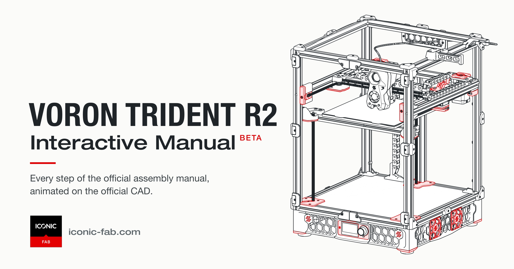
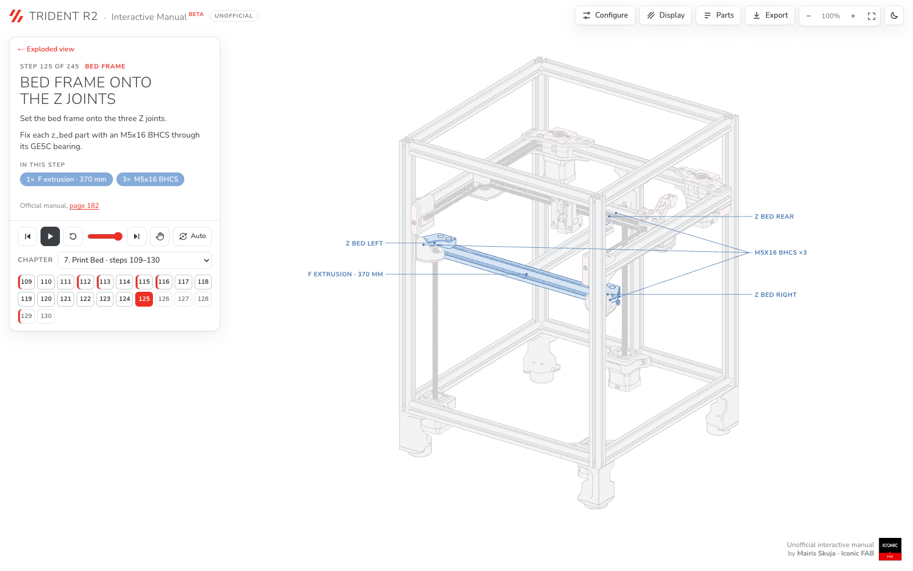
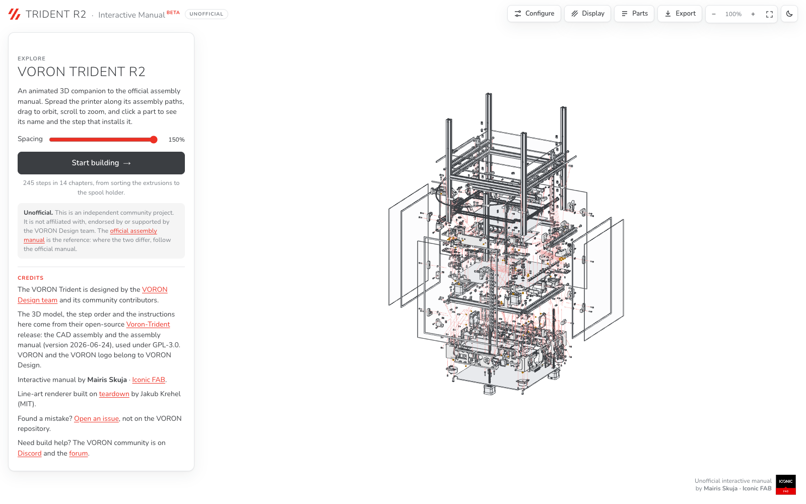

# VORON Trident R2: interactive assembly manual (unofficial)

[](https://iconic-fab.com/voron/trident/r2/)

**Open it: https://iconic-fab.com/voron/trident/r2/** (free, in the browser, no install)

An animated 3D companion to the official [VORON Trident assembly manual](https://github.com/VoronDesign/Voron-Trident/blob/main/Manual/Assembly_Manual_Trident.pdf). Every step of the official manual is shown on the official CAD model: the parts of each step fly into place, labelled, with the manual's text and tips beside them and a link to the page it comes from.

> **Independent community project.** Not affiliated with, endorsed by or supported by the VORON Design team. The official manual is the reference: where the two differ, follow the manual. All credit for the printer, the CAD and the manual goes to the VORON team and community; see [CREDITS.md](CREDITS.md).

**Status:** beta. The whole manual: 14 chapters and 245 steps, from sorting the extrusions to the spool holder (manual pp. 12–316), on the 250 mm build.

## What you can do

| Build step by step | Explore the whole printer |
| --- | --- |
| [](https://iconic-fab.com/voron/trident/r2/#bed-frame-install) | [](https://iconic-fab.com/voron/trident/r2/) |

- **Steps:** play, scrub or replay each step; jump between the 14 chapters; *Auto* plays through the build (double-click it for 2× speed).
- **Exploded view:** pull the whole printer apart along its assembly paths with the spacing slider.
- **Parts:** click any part to see its name and jump to the step that installs it; isolate or recolour it. *Configure* lists the parts and hardware per chapter.
- **Navigation:** drag to orbit, scroll to zoom, right-drag or the hand tool (H) to move the drawing. On phones, the Rotate and Hand buttons choose what one finger does.
- **Display:** linework styles, filled or outline parts, line colour, light and dark mode.
- **Export:** save the current view as SVG, PNG or PDF (A3 hidden-line drawing).
- **Deep links:** every step has its own address, e.g. [`#bed-frame-install`](https://iconic-fab.com/voron/trident/r2/#bed-frame-install).

Where the CAD and the manual differ, the drawing shows the CAD, and the difference is written down (see [How it is made](#how-it-is-made)). Wiring, electronics and mains steps highlight the parts involved, because the CAD has no wires; the manual's safety warnings are kept word for word and the wiring diagrams link to their pages in the official manual.

## Found a mistake?

[Open an issue](https://github.com/mairisskuja/voron-trident-r2-interactive-manual/issues) here, **not** on the VORON repository. Please include the step number (or the step's address) and what is wrong; a screenshot or the manual page helps. Pull requests are welcome: [docs/writing-a-chapter.md](docs/writing-a-chapter.md) explains how a chapter is written and checked.

For help with your build, the VORON community is on [Discord](https://discord.gg/voron) and [r/VORONDesign](https://www.reddit.com/r/VORONDesign).

## How it is made

- **Geometry:** the official `trident_assembly.step` from [VoronDesign/Voron-Trident](https://github.com/VoronDesign/Voron-Trident) at a pinned commit, read with native OpenCascade (1,595 placed solids, 1,138 parts drawn). Hardware meshes (screws, inserts, motors, belts) are simplified to within 0.05 mm of the CAD; printed parts and extrusions are untouched.
- **Steps:** each chapter is a module that picks parts from the CAD product tree and describes the manual's steps: which parts move, from where, the camera, the text, the tips and the manual pages.
- **Records:** [docs/transcripts/](docs/transcripts/) holds a page-by-page transcript of the manual for every chapter, with a "CAD vs manual" section for every place the CAD settles or differs from the manual, and a "Not drawn" list. [evidence.md](evidence.md) covers the first two chapters and the whole model.
- **Rendering:** three.js line art in the browser; exports use the [teardown](https://github.com/jakubkrehel/skills) hidden-line renderer.

## Build

Needs Node 20+, [uv](https://docs.astral.sh/uv/) (for Python 3.12 and native OpenCascade), `curl` and `unzip`.

```bash
npm install         # build tools (meshoptimizer)
npm run setup       # once: Python venv with cadquery-ocp (native OpenCascade)
npm run fetch-cad   # downloads the official STEP from VoronDesign/Voron-Trident (pinned commit)
npm run build:all   # reads the STEP (about 2 minutes), then builds dist/ (index.html + model-<hash>.bin)
npm run serve       # http://localhost:8766/
```

`dist/` is committed, so the current build can also be served as it is.

| Path | What it is |
| --- | --- |
| `CHANGELOG.md` | What changed in each release |
| `tools/catalog.cjs` | Shared helpers and the first two chapters (Frame, A/B Drive and Idler) |
| `tools/chapters/NN-*.cjs` | One module per later chapter: parts, steps, text, manual page references. Edit these to change the manual |
| `docs/transcripts/` | Page-by-page transcripts of the official manual, with the "CAD vs manual" decisions per chapter |
| `docs/writing-a-chapter.md` | How a chapter module is written and checked |
| `tools/snap.cjs` | Renders steps to PNG without a browser, for checking (`node tools/snap.cjs <step id or number>`) |
| `src/` | The page: template, viewer, export worker, logos |
| `tools/step/convert_ocp.py` | Reads the STEP assembly into `build/assembly.json` |
| `tools/simplify-hardware.cjs`, `tools/build-*.cjs` | Simplify the hardware meshes, pack the model and build `dist/index.html` |
| `tools/record-social.mjs` | Records the opening animation as MP4 (square and vertical) |
| `tools/teardown/` | Hidden-line renderer used for exports (MIT, Jakub Krehel) |
| `evidence.md` | Where each fact comes from, and where the CAD settles what the manual leaves open |

## License

GPL-3.0, the same as the VORON Trident it is built from. See [LICENSE](LICENSE). Third-party parts and their licenses are listed in [CREDITS.md](CREDITS.md).

"VORON" and the VORON logo belong to VORON Design and are used only to identify the printer this manual is for.

Made by Mairis Skuja · [Iconic FAB](https://iconic-fab.com).
